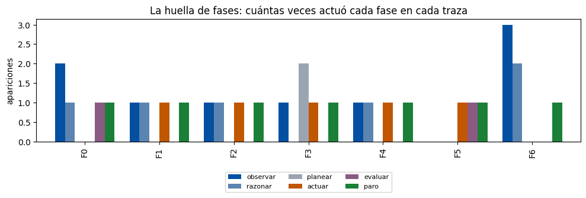

<div style="text-align: center;">

# Skill Lab 2 | Diagnóstico de trazas del ciclo

### Contratos por fase, causa antes que síntoma y verificaciones de la especificación

**Tecnológico de Monterrey** · Maestría en Inteligencia Artificial Aplicada<br>
**IA5004.10 — Sistemas multiagente** · Trimestre sept - dic 2026

**Alumno:** Oscar Alberto Ramírez Anaya · **Matrícula:** A01795438 · **Correo:** A01795438@tec.mx<br>
**Modalidad:** Individual · **Valor:** 5 % · **Fecha:** 18 de octubre de 2026

**Entregable:** [`SkillLab2_A01795438.pdf`](./SkillLab2_A01795438.pdf) ·
**Notebook:** [`SkillLab2_A01795438.ipynb`](./SkillLab2_A01795438.ipynb)

</div>

---

## Resumen

Distribuidora Cuauhtémoc opera un agente que detecta quiebres de inventario y prepara casos para la bandeja
del gerente comercial. El agente trabaja en vueltas de un ciclo de seis fases (observar, razonar, planear,
actuar, evaluar y paro), y cada fase tiene un **contrato**: lo que promete hacer bien. Este laboratorio
audita siete trazas simuladas: **F0** es la referencia y **F1–F6** traen una falla sembrada cada una.

El trabajo del auditor es encontrar en cada traza la **fase primaria** de la falla, es decir, la primera
fase que rompió su contrato y no el síntoma que aparece después. También hay que nombrar la verificación
de la especificación que la habría detenido en ese momento y proponer el cierre que debió emitir F6 al
agotar su presupuesto.

Resultado principal: en **cinco de las seis trazas** el agente declaró **ÉXITO**. Un caso mal
fundamentado llega a la bandeja del gerente con la misma cara que uno bien fundamentado; las verificaciones
por fase son las que los distinguen.

## Cobertura de la rúbrica

| Criterio | Valor | Dónde se atiende en el PDF |
|---|---:|---|
| **Diagnóstico de fases (6 diagnósticos):** fase primaria, causa argumentada y especificación que la detendría | 60 % | Sección 3 (3.1 tabla resumen; 3.2–3.7 un apartado por traza con fase, paso, evidencia, por qué es causa y costo de negocio) |
| **Interpretación de verificaciones y presupuesto:** profundidad, evidencia del notebook, contexto de negocio | 40 % | Sección 4 (verificación, dónde se aplica y por qué funciona, F1–F6) y sección 5 (cierre de F6 con presupuesto de 3 vueltas) |
| **Declaración de uso de IA:** herramientas, propósito y verificaciones | Requisito | Apéndice A (qué se delegó, qué se verificó y qué se decidió) |

## Datos y modalidad

Conjunto común `skill_lab2_datos.json`, igual para todo el grupo (sin códigos personales ni variantes):

| Parámetro | Valor | Uso en las trazas |
|---|---|---|
| `orden` | F0 a F6 | Orden fijo de presentación de los siete registros |
| `tienda` | T0118 | Tienda sin capturas de competencia en F2 |
| `producto` | P051 | Producto con quiebre en F4; el agente consulta por error **P052** |
| `dias_captura` | 34 | Antigüedad de la captura que F1 usa sin revisar su fecha |
| `presupuesto` | 8 | Presupuesto de referencia para la reflexión sobre F6 (no se ejecuta como límite) |

Las trazas se construyen por código (`construir_trazas`) con un `Enum` cerrado de fases y una `dataclass`
inmutable por paso. **No se ejecutan modelos, agentes ni servicios externos, y no hay llamadas a una API.**

## 1. Lectura de las trazas y huella de fases (Parte A)

La huella cuenta cuántas veces aparece cada fase en cada traza. Sirve para decidir **dónde leer primero**,
no como prueba de la causa.

| Traza | observar | razonar | planear | actuar | evaluar | paro |
|---|---:|---:|---:|---:|---:|---:|
| F0 | 2 | 1 | 0 | 0 | 1 | 1 |
| F1 | 1 | 1 | 0 | 1 | 0 | 1 |
| F2 | 1 | 1 | 0 | 1 | 0 | 1 |
| F3 | 1 | 0 | 2 | 1 | 0 | 1 |
| F4 | 1 | 1 | 0 | 1 | 0 | 1 |
| F5 | 0 | 0 | 0 | 1 | 1 | 1 |
| F6 | 3 | 2 | 0 | 0 | 0 | 1 |



- **F6** sobresale en `observar` (3): la lectura confirma que repite la misma consulta.
- **Cinco trazas nunca evalúan** (F1, F2, F3, F4 y F6).
- **F1, F2 y F4 tienen la misma huella** (1-1-0-1-0-1) y fallan en tres fases distintas: el conteo pierde
  el orden y el contenido de los pasos. La huella orienta; el diagnóstico sale de leer la traza.
- **F0** es la vara: ante la duda observa una causa candidata, evalúa contra el contrato y **escala** con dos
  hipótesis en lugar de declarar éxito.

## 2. Diagnósticos de fase primaria (Parte B)

Protocolo del auditor: caminar la traza hacia atrás desde el paro, preguntar en cada paso si la fase cumplió
su contrato con lo que tenía enfrente y quedarse con la **primera** que lo rompió. Todo lo posterior es
síntoma.

| Traza | Fase primaria | Paso | Evidencia en la traza | Por qué es la causa y no el síntoma |
|---|---|---:|---|---|
| F1 | **observar** | 1 | "usa la más reciente SIN revisar fecha (34 días)" | Evidencia real pero no vigente; razonar y actuar trabajan bien con lo que reciben |
| F2 | **razonar** | 2 | "asume causa probable: entrada de competidor (SIN evidencia)" | Observar declaró con honestidad que no había capturas; razonar convirtió el hueco en causa |
| F3 | **planear** | 3 | "continúa el plan original sin revisarlo" tras "inventario del CD normal (contradice la premisa)" | El plan inicial era una hipótesis legítima; lo roto es no revisarlo. Actuar (paso 4) es síntoma |
| F4 | **actuar** | 2 | "consulta ventas del producto P052 (argumento no validado)" con el quiebre en P051 | Actuar ocurre antes que razonar; razonar concluye bien sobre datos equivocados |
| F5 | **evaluar** | 2 | "el propio modelo califica su borrador: «excelente calidad»" | Autoevaluación en lugar de criterios externos; el éxito del paro es síntoma |
| F6 | **paro** | 6 | "PRESUPUESTO AGOTADO sin caso ni declaración" | El presupuesto sí detuvo el bucle; el paro no declaró el estado real ni lo que se sabía |

**Sobre F6**, el diagnóstico más discutible: la huella apunta a `observar`, pero repetir una consulta no
inventa evidencia, pedir más datos ante una señal ambigua es razonable y el presupuesto cumplió su función de
contener la búsqueda. La repetición queda como hallazgo secundario y motiva el detector de repetición de la
sección 3.

## 3. Interpretación 1: verificaciones de la especificación

Cada verificación se coloca en el paso donde nace la falla, para detenerla **en el momento**.

| Traza | Verificación | Dónde se aplica | Por qué funciona |
|---|---|---|---|
| F1 | **Regla de vigencia:** antigüedad máxima por tipo de fuente; lo vencido se rechaza o se marca "no vigente" | Observar, paso 1 | Comparación determinista sobre una fecha disponible (34 días) |
| F2 | **Regla de trazabilidad:** toda causa cita la observación que la respalda; sin cita es hipótesis | Razonar, paso 2 | "Entrada de competidor" no tiene observación que citar |
| F3 | **Precondición de plan:** contrastar el plan con la última observación; si la contradice, replanear o escalar | Planear, paso 3 | Da consecuencia a una contradicción que ya está registrada |
| F4 | **Validación de argumentos:** el producto de la llamada debe coincidir con la entidad del caso (P051) | Actuar, paso 2, antes de la llamada | Es la única defensa: la respuesta de P052 es plausible |
| F5 | **Evaluador externo:** rúbrica de la especificación y verificador distinto del generador | Evaluar, paso 2 | Reemplaza una opinión por criterios comprobables |
| F6 | **Contrato del paro por límite** y **detector de repetición** | Paro, paso 6 (refuerzo en el paso 3) | Prohíbe cerrar con un estado vacío y corta consultas idénticas |

Como red adicional, una verificación transversal en el paro (ningún éxito sin evidencia citada y evaluación
externa) habría convertido los cinco "ÉXITO declarado" en escalamientos.

## 4. Interpretación 2: el paro por presupuesto en F6

Los registros de F6 no traen un contador de vueltas: cinco registros antes del paro no equivalen a cinco
vueltas, así que no se calcula en qué punto cortaría un límite de 3. **Reducir el presupuesto no corrige la
falla, solo la adelanta**; lo que la corrige es un paro por límite bien especificado. Cierre propuesto:

```text
ESTADO: LÍMITE ALCANZADO (presupuesto de 3 vueltas) SIN CONCLUSIÓN. No es un éxito.

QUÉ SE SABE
- Se detectó una señal ambigua de posible quiebre (paso 1).
- La consulta realizada para aclararla no aportó evidencia nueva; se repitió
  sin cambios (pasos 3 y 5).

QUÉ FALTA
- Evidencia que confirme o descarte el quiebre: inventario actual del
  producto en la tienda y en el CD, ventas recientes y promociones activas.
- No hay hipótesis de causa sustentadas; no se emite recomendación.

SIGUIENTE PASO
- Escalar al gerente comercial como caso incompleto, con la traza adjunta.
- Sugerencia: consultar una fuente distinta a la repetida, o verificar en
  piso con el preventista antes de reabrir el caso con un presupuesto nuevo.
```

Cumple las tres condiciones que pide el notebook: declaración honesta del límite, caso incompleto con lo que
sí se supo y la traza para quien continúe.

## 5. Conclusiones

- **Diagnóstico más difícil: F6.** La huella invita a culpar a `observar`, pero el contrato roto es el del paro.
- **Verificación que se instalaría primero:** validación de argumentos antes de llamar una herramienta (F4);
  en integraciones PMS/POS un identificador equivocado devuelve un resultado plausible que nadie cuestiona.
- **Huella de fases en la organización:** auditar tickets de soporte contando repeticiones de "solicitar más
  información" frente a cierres con verificación del cliente.

## Notebook

- **Visualizar en GitHub:** [`SkillLab2_A01795438.ipynb`](./SkillLab2_A01795438.ipynb)
- **Visor enriquecido (nbviewer):** https://nbviewer.org/github/oscar-ramirez-anaya/SkillLab2_A01795438/blob/main/SkillLab2_A01795438.ipynb
- **Descargar (raw):** https://raw.githubusercontent.com/oscar-ramirez-anaya/SkillLab2_A01795438/main/SkillLab2_A01795438.ipynb

El notebook está ejecutado con salidas: las celdas DECISIÓN (`DIAGNOSTICOS`, `VERIFICACIONES`,
`DECLARACION_IA`) están completas, el validador de formato no reporta pendientes y la celda de pruebas
confirma los cuatro grupos de comprobaciones locales (datos comunes, registros, `Paso` y formato de
diagnósticos).

## Estructura del repositorio

```
.
├── SkillLab2_A01795438.pdf       # Entregable para Canvas (13 páginas)
├── SkillLab2_A01795438.ipynb     # Notebook del laboratorio, completado y ejecutado con salidas
├── skill_lab2_datos.json         # Conjunto común del laboratorio
├── figuras/
│   └── huella_de_fases.png       # Gráfica de la huella exportada del notebook
├── reporte/
│   ├── reporte_tpl.html          # Fuente del PDF (portada, índice, secciones, apéndice, glosario)
│   ├── logo_tec.png              # Logo de la portada
│   └── generar_pdf.py            # Render con Chrome headless, índice paginado y pie de página
├── README.md
└── .gitignore
```

## Reproducir

**Notebook.** Requiere Python 3 con `pandas` y `matplotlib`. Coloca el notebook y `skill_lab2_datos.json`
en la misma carpeta y ejecuta las celdas en orden; en Colab, sube el JSON al panel de archivos de la sesión.
Desde la terminal:

```bash
python3 -m jupyter nbconvert --to notebook --execute --inplace SkillLab2_A01795438.ipynb
```

**PDF.** Requiere Google Chrome y los paquetes `pypdf` y `reportlab`. El script calcula las páginas del
índice, numera las páginas y deja el PDF en `reporte/`:

```bash
cd reporte
python3 generar_pdf.py
mv SkillLab2_A01795438.pdf ..
```

## Referencias

- Hunter, J. D. (2007). Matplotlib: A 2D graphics environment. *Computing in Science & Engineering, 9*(3), 90–95. https://doi.org/10.1109/MCSE.2007.55
- McKinney, W. (2010). Data structures for statistical computing in Python. En *Proceedings of the 9th Python in Science Conference* (pp. 56–61). https://doi.org/10.25080/Majora-92bf1922-00a
- Panickssery, A., Bowman, S. R., & Feng, S. (2024). LLM evaluators recognize and favor their own generations. En *Advances in Neural Information Processing Systems, 37*. https://arxiv.org/abs/2404.13076
- Tecnológico de Monterrey. (2026). *Skill Lab 2: Diagnóstico de trazas del ciclo* [Notebook y conjunto común de datos; material del curso IA5004.10 Sistemas multiagente]. Experiencia21.
- Yao, S., Zhao, J., Yu, D., Du, N., Shafran, I., Narasimhan, K., & Cao, Y. (2023). ReAct: Synergizing reasoning and acting in language models. En *ICLR 2023*. https://arxiv.org/abs/2210.03629
- Zheng, L., Chiang, W.-L., Sheng, Y., Zhuang, S., Wu, Z., Zhuang, Y., Lin, Z., Li, Z., Li, D., Xing, E. P., Zhang, H., Gonzalez, J. E., & Stoica, I. (2023). Judging LLM-as-a-judge with MT-Bench and Chatbot Arena. En *Advances in Neural Information Processing Systems, 36*. https://arxiv.org/abs/2306.05685

---

*Datos: trazas didácticas simuladas del caso Distribuidora Cuauhtémoc, construidas por código a partir del
conjunto común del curso. No representan registros internos de un modelo ni operaciones reales.*
